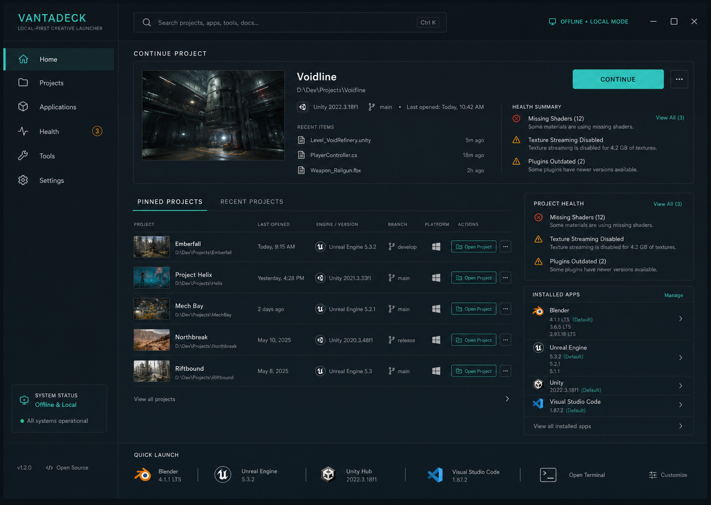

<div align="center">

# Pipeline OS

**A free, local-first home base for game, CG, VFX and animation projects.**

Find your creative apps, open projects in the right version, run builds and renders, track work, and manage Git — from one desktop app and a scriptable CLI. No account, no cloud, no telemetry.

[](https://github.com/ojaseminem/Pipeline-OS/actions/workflows/ci.yml)
[](https://github.com/ojaseminem/Pipeline-OS/actions/workflows/security.yml)
[](https://github.com/ojaseminem/Pipeline-OS/releases/latest)
[](LICENSE)

[Download](#download) · [Features](#features) · [Works offline](#works-offline) · [CLI](#command-line) · [Build from source](#build-from-source) · [Contributing](#contributing)

</div>



## Why

A single game or film project leans on many tools: an engine (often a specific version), DCC apps, editors, source control, build scripts. Pipeline OS keeps all of that in one place on your machine:

- **Free and open source.** MIT-licensed for personal and commercial use. No tiers, seats or feature gates.
- **Local-first.** Projects, preferences, history and caches stay on your computer.
- **Works offline.** Everything except the features that talk to a server keeps working with no connection (details [below](#works-offline)).
- **No account, no telemetry.** Nothing is sent anywhere unless you ask for it.
- **Team-friendly.** Shared settings live in plain files in the repo (`.pipelineos/`), with relative paths, so they travel through version control.
- **Scriptable.** The desktop app and the `vantadeck` CLI use the same Rust core, and the CLI has stable JSON output for automation and AI agents.

## Download

| Platform | Get it |
| --- | --- |
| Windows 10/11 (x64) | `PipelineOS_<version>_x64-setup.exe` or `.msi` |
| macOS (Apple Silicon) | `PipelineOS_<version>_aarch64.dmg` |
| Linux (x64) | `.AppImage`, `.deb` or `.rpm` |

All on the **[latest release](https://github.com/ojaseminem/Pipeline-OS/releases/latest)**. Once installed, the app updates itself.

Installers aren't code-signed by Microsoft or Apple yet, so the first launch needs one extra step:

- **Windows:** SmartScreen shows "unknown publisher". Choose *More info → Run anyway*.
- **macOS:** right-click the app → *Open* → *Open*, or run `xattr -dr com.apple.quarantine "/Applications/PipelineOS.app"`.

Update files are signed, and every release ships checksums (`SHA256SUMS.txt`), SBOMs and Sigstore build provenance.

**Dev builds.** To try the newest work early, install **PipelineOS Dev** from the rolling [`dev-latest` pre-release](https://github.com/ojaseminem/Pipeline-OS/releases/tag/dev-latest) (Windows, macOS Apple Silicon and Intel). It installs alongside the stable app with its own data, and updates itself from the `dev` branch.

## Features

### Apps and projects
- **Finds your creative apps automatically**, including multiple versions side by side: 60+ apps such as Unity, Unreal Engine, Godot, Blender, Maya, Houdini, 3ds Max, Cinema 4D, ZBrush, Substance, Photoshop, Krita, Aseprite, Spine, DaVinci Resolve, Nuke, Wwise, FMOD, Rider, VS Code, Visual Studio, Xcode, Git and Perforce.
- **Detects on every OS**: Windows (Registry, Unity Hub, Epic, Steam, shortcuts), macOS (app bundles in Applications folders) and Linux (desktop entries, Flatpak, Snap, AppImage), plus PATH and common install folders.
- **Imports projects** for Unity, Unreal, Godot, Blender/Maya and any creative folder, and finds projects already on your disk.
- **Opens projects in the right version**, with preferred and fallback versions, launch profiles, and per-machine overrides that are never committed.
- **Suggests the tools a project uses** (Maya, Substance, Houdini…) from the files it contains.
- **Pins, search and recent projects**, with a small search box next to *Pinned / Recent*.

### Studio workflows
- **Pipeline tasks.** One-click builds, cooks, renders, exports and tests from templates (Unity batch mode, Unreal BuildCookRun, Godot export, Blender render, or your own). Live logs, cancel, and run history. Commands that arrive through the repo must be reviewed and trusted on your machine before they run.
- **Board.** A Kanban board per project, stored as one small file per issue under `.pipelineos/issues/`, so it merges cleanly through Git. *Open work* on Home shows everything across projects. Optional sync with GitHub Issues, Jira, Linear and others.
- **Asset library.** Concept art, references, models, audio and video with review status (WIP / In review / Approved), notes and studio folder layouts.
- **Engine activity and time.** See what the engine is doing from its logs, and how long you've worked on each project (kept locally).

### Source control
- Git status, diffs, history, branches, stash on switch, commit, pull, push and one-click sync, in the style of GitHub Desktop.
- Merge-conflict help (including automatic merging of TOML settings), pre-commit checks, and guarded branch deletion.
- GitHub pull requests and CI checks for the current branch, with failed-job logs. This uses an optional token kept in your OS keychain.
- Git LFS checks that only warn when a project actually has large files.
- Perforce support (experimental; not yet tested against a live server).

### AI-ready
- Start Claude Code, Codex, Gemini, Aider or a terminal inside any project.
- A generated **project brief** tells agents the engine, how to build, and which folders to leave alone.
- A built-in **MCP server** (`vantadeck mcp`) lets Claude Desktop, Claude Code, Cursor and others work with your projects, tasks and issues. The app can set this up for you. See [AI_INTEGRATION.md](docs/AI_INTEGRATION.md).

### Desktop experience
- 11 themes, including light, dark, glass and high-contrast, plus custom accent colors and reduced motion.
- A command palette (`Ctrl/⌘+K`) for everything, plus shortcuts for new project, undo/redo and back/forward. Press `?` to see them all.
- An activity screen showing every running task across projects.

## Works offline

Pipeline OS runs entirely on your machine. With no internet connection you can still:

- browse, search, pin, import and open projects, and launch apps;
- detect apps and discover projects on disk;
- run pipeline tasks and see their logs and history;
- use the board, asset library, project brief and MCP server;
- use Git locally: status, diffs, history, branches, stash and commits.

Only these features need a connection:

| Feature | Offline behavior |
| --- | --- |
| Git fetch / pull / push / sync | Tries once more, then says the remote isn't reachable. Local commits are safe. |
| GitHub pull requests and checks | Shows "GitHub isn't reachable", and refreshes on its own once you're back online. |
| Tracker sync (GitHub Issues, Jira, Linear…) | Says the tracker isn't reachable; your local board is unaffected. |
| Update check (at launch if auto-update is on, or from Settings) | Fails quietly at launch. A manual check says it couldn't reach the server instead of claiming you're up to date. |

## Command line

The `vantadeck` CLI ships inside the desktop app (it powers the MCP server) and can also be built from source with `cargo run -p vantadeck`. It exposes the same features. Every command supports `--json`, which returns a stable envelope (`schemaVersion`, `command`, `success`, `data`, `warnings`, `errors`). Commands that change something or touch a remote require `--yes`.

```bash
vantadeck scan apps                                   # detect installed apps
vantadeck project import ~/Projects/MyGame            # add a project
vantadeck project launch ~/Projects/MyGame editor     # open it with a launch profile
vantadeck project vcs ~/Projects/MyGame sync --yes    # fetch, pull and push
vantadeck tasks run ~/Projects/MyGame build --yes     # run a pipeline task
vantadeck issues list ~/Projects/MyGame               # the project's board
vantadeck context ~/Projects/MyGame                   # AI-ready project brief
vantadeck discover                                    # projects not added yet
vantadeck mcp                                         # serve AI agents over MCP (stdio)
```

Run `vantadeck --help` or `vantadeck <command> --help` for everything. Automation details and exit codes are in [HEADLESS_MODE.md](docs/HEADLESS_MODE.md).

## Project files

Shared, team-owned settings live in the project's `.pipelineos/` folder and are meant to be committed:

```toml
# .pipelineos/project.toml
schema_version = 1
name = "My Game"
project_type = "game-development"

[[linked_apps]]
app_id = "unity"
preferred_version = "6000.0.0"

[[launch_profiles]]
id = "editor"
name = "Open Editor"
app_id = "unity"
arguments = ["-projectPath", "{projectRoot}"]
```

Pipeline tasks live in `.pipelineos/tasks.toml` and issues in `.pipelineos/issues/`. Absolute paths, credentials and personal preferences never go in these files; they stay in the app's local data. The full contract is in [PROJECT_SPEC.md](docs/PROJECT_SPEC.md). Older `.vantadeck/` folders are migrated automatically.

## Build from source

Requirements: [Rust 1.96](https://www.rust-lang.org/tools/install), [Node.js 24](https://nodejs.org/) with npm 11, and Git. Also install the [Tauri prerequisites](https://v2.tauri.app/start/prerequisites/) for your OS (WebView2 on Windows, Xcode Command Line Tools on macOS, WebKitGTK on Linux).

```bash
git clone https://github.com/ojaseminem/Pipeline-OS.git
cd Pipeline-OS
npm install

# Desktop app with hot reload
npm run tauri --workspace @vantadeck/desktop -- dev

# CLI
cargo run -p vantadeck -- --help
```

Before opening a pull request, run the same checks CI runs:

```bash
cargo fmt --all --check
cargo clippy --workspace --all-targets -- -D warnings
cargo test --workspace
npm run typecheck && npm run lint && npm test && npm run build
```

## Architecture

```text
Desktop app (Tauri 2 + React) ──┐
                                ├── Rust application services ── SQLite (local state)
CLI + MCP server (vantadeck) ───┘           │
                                            ├── detection   app discovery per OS
                                            ├── projects    import, validation, safe writes
                                            ├── launcher    structured, shell-free launches
                                            ├── vcs         Git, Git LFS, Perforce
                                            ├── studio      tasks, board, assets, trackers, GitHub
                                            └── health      project health checks
```

The code lives in a Cargo workspace (`crates/`) plus two apps (`apps/desktop`, `apps/cli`). The internal crate and package names still use the project's original name, **Vantadeck**. See [ARCHITECTURE.md](docs/ARCHITECTURE.md).

## Privacy and security

- No account, telemetry, analytics or ads. The network is only used for the features listed in [Works offline](#works-offline). The launch-time update check can be turned off in Settings.
- Tokens are stored in the OS keychain, never in SQLite or project files. Git and Perforce use your existing CLI credentials.
- Apps are launched with structured arguments, never through a shell. Task commands from a repository need your review before they run.
- Downloaded content is never executed automatically.

Report vulnerabilities privately as described in [SECURITY.md](SECURITY.md).

## Status

**0.5** is the current release. It is stable for daily use on Windows, and macOS and Linux builds ship with every release. Still open before 1.0: Microsoft/Apple installer signing, clean-machine validation on each OS, and live Perforce testing. See [BLOCKERS.md](docs/release/BLOCKERS.md) and the [roadmap](ROADMAP.md).

## Contributing

Contributions from developers, artists, technical artists, pipeline engineers, writers and testers are welcome.

1. Read [CONTRIBUTING.md](CONTRIBUTING.md) and the [Code of Conduct](CODE_OF_CONDUCT.md).
2. For behavior or public-contract changes, start with an issue or an [RFC](docs/RFC_PROCESS.md).
3. Add tests, note any network or privacy impact, and run the checks above.
4. Sign off commits (`git commit -s`) per the [DCO](DCO.txt).

More: [Governance](GOVERNANCE.md) · [Releasing](RELEASING.md) · [Privacy](PRIVACY.md) · [Support](SUPPORT.md) · [Funding](FUNDING_DISCLOSURE.md) · [Trademark](TRADEMARK.md)

## License

[MIT](LICENSE) for code; documentation is CC BY 4.0 unless a file says otherwise.
